# Product Requirements Document (PRD)

## Project Name: PrepStride
**Tagline:** Your Quiet, Cheerful UPSC CSE Preparation & Timesheet Companion  
**Target User:** UPSC CSE Aspirant (Primary) & Supportive Partner (Secondary)  
**Target Timeline:** CSE 2027 / Flexible Long-Term Marathon  
**Platform:** Progressive Web App (PWA) — Mobile-First, 100% Offline Capable  
**Hosting & Cost:** GitHub Pages (100% Free, Zero Backend Maintenance)  
**Data Model:** Local-First (Browser IndexedDB via Dexie.js) with 1-Tap Partner Share & JSON Backup  
**Official Mascot:** **Pip the Stride Bird** (The Aspirant's Cheerful Study Companion)  

---

## 1. Executive Summary & Problem Statement

Preparing for the Indian Civil Services Examination (UPSC CSE) is an intense, multi-year intellectual and emotional marathon. Aspirants must juggle:
- A vast, multi-disciplinary syllabus (General Studies 1–4, Optional Subject Paper 1 & 2, Essay, CSAT, and 18+ months of Current Affairs).
- Strict daily study discipline (typically 7–10 hours daily).
- The "Forgetting Curve" — standard reference books (Laxmikanth, Spectrum, etc.) require 3 to 5 spaced revision cycles to be retained under exam stress.
- Preliminary negative marking risks and Mains subjective answer writing practice.

### Why Existing Solutions Fail Aspirants:
1. **Generic Habit/Time Trackers (Forest, Toggl, Notion):** Too abstract or overly complex to set up. They lack UPSC-native taxonomies (GS papers, Optionals, CSAT, Prelims negative marks calculation).
2. **Heavy Cloud Apps:** Require constant logins, become sluggish, consume phone battery, and fail completely in basement libraries or flight mode where aspirants study to avoid social media distractions.
3. **High Data Entry Friction:** Stressed aspirants will abandon any tool that takes more than 5 seconds to log an activity.
4. **Partner Disconnect:** Partners want to cheer them on and stay updated without adding pressure or demanding phone calls during study hours.

### The PrepStride Solution:
**PrepStride** is a fast, calm, mobile-first PWA crafted specifically for UPSC aspirants. It operates 100% offline via local IndexedDB, offers frictionless hybrid time logging, tracks micro-topic syllabus progression, automates spaced revision cycles, analyzes mock test performance, awards uplifting gamification & partner-redeemable rewards, and enables a 1-tap end-of-day summary share for partner encouragement.

---

## 2. Brand Identity & Mascot: Pip the Stride Bird


### The Mascot Concept:
**"Pip"** is a vibrant, warm, and delightfully expressive little fledgling bird with colorful wings (pink, golden-yellow, sky-blue) and charming dark feathers. Pip is not a naggy reminder bot; Pip is her quiet, faithful study companion who sits beside her desk through long hours of polity, history, and mock tests.

### Dynamic Mascot States Across PrepStride:
1. **The Morning Kickoff (Dashboard):** Pip peeks out from the hours progress ring with an energetic expression, offering an inspiring quote (*"Every single page you read today brings you closer to Mussoorie!"*).
2. **The Focused Scholar (During Pomodoro / Timer):** Pip sits peacefully with a tiny pair of study spectacles, breathing softly in zen mode to maintain a calm, distraction-free environment.
3. **The Victory Dance (Daily Goal Met / Milestone Reached):** Pip spreads wings in full celebratory joy with confetti (*"Target crushed today! You're unstoppable!"*).
4. **The Rest Guardian (Streak Shield / Rest Day):** When a rest day is taken or a Streak Shield is activated, Pip snuggles under a cozy little leaf blanket sleeping soundly (*"Rest well, champion. Recovery is part of the strategy."*).
5. **The Daily Share Ambassador:** Pip stands proudly on the 1-Tap Partner Share Card holding an olive branch or cheer flag, making the WhatsApp update card immediately warm, affectionate, and personal.
6. **App Icon & Splash Screen:** Pip's smiling face forms the official PWA home screen icon and loading splash.

---

## 3. Core Personas & User Journey

### Persona A: The Aspirant (Your Wife)
- **Goal:** Maintain daily consistency over months and years, track syllabus completion across Prelims & Mains, ensure repeated revision cycles, and see tangible progress without cognitive fatigue.
- **Pain Points:** Fatigue at the end of a 9-hour study day; anxiety about whether she's revising topics on time; spotty library Wi-Fi; guilt when tracking apps feel like chores.
- **App Behavior:** 
  - **Morning:** Opens PrepStride, sets target hours for the day, checks daily ritual checklist (Newspaper, Answer Writing), greeted by Pip.
  - **Study Sessions:** Uses Pomodoro timer or distraction-free stopwatch.
  - **End of Session/Day:** Enters quick retro logs if timer wasn't running, ticks off completed syllabus topics, rates daily energy.
  - **Night:** Taps "Share Daily Digest" to send a beautiful summary card to her husband in 1 second, unlocks any earned "Treat Box" coupons.

### Persona B: The Supportive Partner (You)
- **Goal:** Stay informed about her daily effort, celebrate her milestones, offer empathy on tough days, and provide emotional support without asking "How much did you study today?".
- **Touchpoint:** Receives a clean, uplifting visual card/message each evening featuring Pip, hours logged, subjects tackled, and her daily energy rating.

---

## 4. Guiding Product Principles

1. **3-Second Interaction Rule:** Every primary action (logging study time, ticking a ritual, marking a revision) must take 3 seconds or fewer.
2. **Local & Distraction-Free:** No notifications urging engagement, no social leaderboards, zero ads. Designed to respect the aspirant's peace of mind.
3. **100% Offline-First:** Must function flawlessly in airplane mode, libraries, or network blackouts.
4. **UPSC-Native Taxonomy:** Pre-built around Prelims, GS1, GS2, GS3, GS4, Essay, CSAT, and customizable Optional subjects.
5. **Effort-Centric & Gentle:** Celebrates discipline and consistency over punitive failure metrics.

---

## 5. Comprehensive Feature Specifications ("The Entire Package")

```mermaid
flowchart TD
    App["PrepStride PWA"]
    
    App --> Mod1["1. Timesheet & Hybrid Timer"]
    App --> Mod2["2. Consistency & Heatmaps"]
    App --> Mod3["3. Micro-Syllabus Tracker"]
    App --> Mod4["4. Revision Spaced Repetition"]
    App --> Mod5["5. Daily UPSC Rituals"]
    App --> Mod6["6. Mock Test Analytics"]
    App --> Mod7["7. Prelims Mistake Logbook"]
    App --> Mod8["8. Resource & Booklist"]
    App --> Mod9["9. 1-Tap Partner Share"]
    App --> Mod10["10. Mental Health & Zen"]
    App --> Mod11["11. Data Sovereignty & Backup"]
    App --> Mod12["12. Gamification & 'Treat Box' Rewards"]
```



### Module 1: Daily Timesheet & Hybrid Time Tracking
- **Two Tracking Modes:**
  1. **Active Timer (Pomodoro / Stopwatch):** 
     - Focus timer with configurable intervals (e.g. 50 min study / 10 min break or custom Pomodoro).
     - Full-screen zen mode showing subject, topic, and elapsed time with Pip in quiet focus mode.
     - Auto-saves session upon completion or stop.
  2. **Quick Retrospective Entry:**
     - For logging offline hours spent in coaching classes, library, or offline reading.
     - Single-screen modal: Select Subject (1-tap chip) $\rightarrow$ Duration (quick presets: 30m, 1h, 1.5h, 2h, 3h or slider) $\rightarrow$ Optional topic note $\rightarrow$ Save.
- **Subject Categories (Color-Coded):**
  - GS 1 (History, Geography, Art & Culture, Society)
  - GS 2 (Polity, Governance, Social Justice, IR)
  - GS 3 (Economy, Science & Tech, Environment, Security, Disaster Mgmt)
  - GS 4 (Ethics, Integrity, Aptitude, Case Studies)
  - Optional Subject (Paper 1 & Paper 2)
  - Essay & Answer Writing
  - CSAT (Quant, Reasoning, Reading Comprehension)
  - Current Affairs & Newspaper
- **Daily Planned vs Actual Hours:**
  - Daily target setter (e.g., 8 hours).
  - Real-time circular progress ring on the dashboard with Pip cheering her on.

### Module 2: Consistency Analytics & GitHub-Style Heatmap
- **Annual Heatmap:**
  - 365-day contribution grid displaying daily study volume via gradient color intensity.
  - Visualizing multi-month streaks to sustain momentum toward CSE 2027.
- **Visual Analytics:**
  - Weekly & monthly total study hours.
  - Subject distribution chart (identifying if Optional or CSAT is being neglected).
  - Average daily hours rolling metric (7-day / 30-day).

### Module 3: Pre-Loaded Micro-Topic Syllabus Checklist
- **Prelims & Mains GS 1–4 Built-In:**
  - Complete official UPSC syllabus broken down into searchable, granular micro-topics.
  - Multi-state topic tracker:
    - `Not Started`
    - `First Reading Complete`
    - `Notes Prepared`
    - `Revision 1 Done`
    - `Revision 2 Done`
    - `Mastered`
  - Real-time completion percentage per paper and overall.
- **Customizable Optional Subject Builder:**
  - Pre-populated starter templates for top Optionals: **PSIR, Sociology, Geography, Anthropology, Public Administration, History**.
  - Custom topic adder: Aspirant can freely add, edit, or paste chapters/papers for any other optional subject.

### Module 4: Spaced Repetition & Revision Cycle Engine
- **Why it matters:** UPSC syllabus cannot be remembered without at least 3-4 structured passes.
- **Features:**
  - Dedicated "Revision Queue" showing topics/books flagged for review.
  - Preset revision cadences (e.g., Spaced Repetition: Day 1 $\rightarrow$ Day 7 $\rightarrow$ Day 21 $\rightarrow$ Day 60).
  - Quick "Rev Incrementer": 1-tap increments topic from `Rev 1` to `Rev 2` to `Rev 3+` with timestamp.
  - "Stale Topic Alert": Highlights high-yield subjects (e.g. Modern History or Environment) that haven't been reviewed in $>30$ days.

### Module 5: Daily UPSC Rituals Checklist
- Non-negotiable daily habits tracked as quick toggle checkboxes:
  - [ ] Newspaper reading (*The Hindu* / *Indian Express*)
  - [ ] Editorial summary notes made
  - [ ] Daily MCQs practice (10–20 questions)
  - [ ] Daily Answer Writing (1–2 Mains questions)
  - [ ] Monthly CA magazine reading (Vision IAS / Vajiram / InsightsonIndia)
  - [ ] CSAT weekly practice drill
- Auto-resets daily at midnight while preserving historical streak data.

### Module 6: Mock Test & Test Series Analyzer
- **Prelims Mock Tests:**
  - Input: Test Series Name (e.g. Vision IAS Test 5, Forum IAS Simulator 2), Total Questions, Questions Attempted, Correct, Incorrect.
  - Automatic Calculations:
    $$\text{Score} = (\text{Correct} \times 2) - (\text{Incorrect} \times 0.666)$$
    $$\text{Accuracy Rate} = \left(\frac{\text{Correct}}{\text{Attempted}}\right) \times 100\%$$
  - Trend graph showing Prelims mock score progression over time against target benchmark (e.g., 100+ marks).
- **Mains Test Series:**
  - Input: Test paper (GS1/GS2/GS3/GS4/Essay/Optional), Total Marks, Marks Obtained, Strengths, Mentor feedback tags.

### Module 7: Prelims Mistake Logbook ("Error Diary")
- Aspirants lose Prelims on preventable mistakes.
- Log every incorrect question with a categorical tag:
  - `Silly Mistake / Misread Question`
  - `Conceptual Gap`
  - `Factual Recall Failure`
  - `Elimination / Risk Calculation Error`
- Searchable question summary and key takeaway for quick pre-exam review.

### Module 8: Resource & Booklist Tracker
- Built-in tracking of standard foundational texts:
  - *Indian Polity* (M. Laxmikanth)
  - *Modern Indian History* (Spectrum / Rajiv Ahir)
  - *Environment* (Shankar IAS / PMF IAS)
  - *Indian Economy* (Nitin Singhania / Ramesh Singh / Mrunal)
  - *Ancient & Medieval History* (RS Sharma / Satish Chandra / Old NCERTs)
  - *Art & Culture* (Nitin Singhania)
  - *Geography* (Class 11 & 12 NCERTs + GC Leong)
  - *Ethics* (Lexicon / Subba Rao)
- Read status, total chapters, chapters completed, revision count per book.

### Module 9: 1-Tap Partner Daily Summary Share
- **Zero-Backend Architecture:** Generates the shareable content entirely in the browser.
- **Output Formats:**
  1. **Visual Daily Card (PNG Image):** Beautiful, minimalist status card showing:
     - Pip the mascot holding a celebration banner
     - Date & D-Day countdown
     - Total hours logged today
     - Primary subjects studied
     - Rituals completed (e.g. "The Hindu ✓", "2 Answers Written ✓")
     - Mood / Energy rating (e.g. "🔥 High Focus" or "😴 Exhausted but proud")
     - Uplifting daily quote
  2. **Formatted Text Message:** Ready to send via WhatsApp / Telegram in 1 tap using `navigator.share` or auto-copy to clipboard.

### Module 10: Mental Health, Energy & Countdown D-Day
- **Countdown Clocks:**
  - Target D-Day indicator (e.g. "Prelims 2027: X days to go").
- **Daily Reflection & Energy Scale:**
  - 1–5 stars for Focus and Energy.
  - Optional 1-sentence reflection: *"What went well today? What will I adjust tomorrow?"*.
- **Zen Mode / Calming Aesthetics:**
  - Soft, warm paper tone (Sepia / Warm White) or Deep Charcoal Dark Mode.
  - Distraction-free typography.

### Module 11: Data Sovereignty, Backup & Offline PWA
- **Local-First (Dexie.js / IndexedDB):** Zero server latency, instant operations.
- **1-Click Backup:** Export complete data store to a human-readable, timestamped `.json` file.
- **1-Click Restore:** Upload previous backup to restore entire history on any device.
- **Automated Weekly Backup Reminder:** Gentle modal prompt every 7 days suggesting an export to device storage or Google Drive.
- **PWA Installation:** Installable to Home Screen on iOS (Safari $\rightarrow$ Add to Home Screen) and Android (Chrome $\rightarrow$ Install App). Full offline caching via Workbox Service Worker.

### Module 12: Gamification, Badges & "Treat Box" Rewards
- **Philosophy:** Gamification for UPSC must be dignified, psychologically uplifting, and free of shallow gimmicks. It honors long-term dedication, celebrates consistency, and integrates partner support into real-world rewards.
- **1. Civil Services Journey Ranks (Study XP):**
  - XP earned through active focus and disciplined habits:
    - $+10 \text{ XP}$ per 30 minutes of logged study time.
    - $+25 \text{ XP}$ per completed daily ritual (*The Hindu*, Editorial notes, Answer writing).
    - $+50 \text{ XP}$ per syllabus micro-topic revision cycle completed.
    - $+100 \text{ XP}$ per Mock Test analyzed and reviewed.
  - Progression Tiers:
    - **Rank 1: The Novice Aspirant** ($0\text{--}499\text{ XP}$) — Pip is a cheerful fledgling.
    - **Rank 2: Discipline Disciple** ($500\text{--}1,499\text{ XP}$) — Pip wears a little study scarf.
    - **Rank 3: Foundation Master** ($1,500\text{--}3,499\text{ XP}$) — Pip holds a mini notebook.
    - **Rank 4: Mains Strategist** ($3,500\text{--}6,999\text{ XP}$) — Pip gains scholarly spectacles.
    - **Rank 5: Revision Virtuoso** ($7,000\text{--}11,999\text{ XP}$) — Pip holds an olive branch quill.
    - **Rank 6: District Magistrate in the Making** ($12,000\text{--}19,999\text{ XP}$) — Pip wears an administrative badge.
    - **Rank 7: LBSNAA Valedictorian** ($20,000+\text{ XP}$) — Pip wears a golden celebratory sash!
- **2. UPSC Badges of Honor (Milestone Trophies):**
  - 🏛️ *Polity Sovereign*: Completed Rev 1, 2, and 3 for all *Indian Polity* (Laxmikanth) chapters.
  - 📰 *Editorial Hawk*: Maintained a 14-day continuous streak of newspaper analysis.
  - 🎯 *Negative Marking Tamer*: Achieved $\ge 75\%$ accuracy on a full 100-question Prelims test.
  - ✍️ *Answer Alchemist*: Logged 25 Mains answers written and self-evaluated.
  - 🌅 *Dawn Warrior*: Completed a 2-hour study session before 8:00 AM.
  - 🌙 *Midnight Scholar*: Logged deep study hours after 10:00 PM.
  - 🧘‍♀️ *Iron Will*: Logged $\ge 4$ hours on a day when energy was rated 1 or 2 stars.
  - 💯 *The Century Club*: Surpassed 100 cumulative focused study hours.
- **3. Streak Shields ("Rest Day Grace" - Burnout Prevention):**
  - Unlike generic apps that punish users for rest, PrepStride protects the aspirant's mental wellbeing.
  - For every 7 consecutive days of meeting the daily study target, she earns **1 Streak Shield** (stored up to 3).
  - If she is unwell or takes an intentional Sunday rest day, a Streak Shield automatically activates to safeguard her multi-week streak without guilt or reset, showing Pip sleeping peacefully in a leaf hammock.
- **4. In-App Visual & Auditory Unlockables:**
  - *Unlockable Themes*: "Mussoorie Mist" (Forest calm), "Old Rajinder Nagar Midnight" (Focus dark), "Warm Parchment" (Sepia reader), and "LBSNAA Gold".
  - *Zen Audio Chimes*: Gentle Tibetan singing bowl chime upon completing Pomodoro sessions.
- **5. Partner "Treat Box" (Real-World Couple Rewards):**
  - Translates digital milestones into real-world care and quality time with her husband.
  - When reaching specific milestones (e.g., Leveling up, 14-day streak, 100 study hours, or completing GS1 syllabus), she unlocks a "Partner Treat Coupon":
    - 🍝 *Chef's Special*: Partner cooks her favorite dinner.
    - 🎬 *Guilt-Free Movie & Popcorn Night*: Movie marathon with zero exam talk.
    - ☕ *Coffee Date / Long Drive*: Relaxing evening decompression.
    - 💆‍♀️ *Head & Shoulder Massage*: Relief after an intensive revision day.
    - 📚 *Stationery / Book Shopping Spree*: Treat herself on his tab.
    - 🌴 *Guilt-Free Sloth Day*: An entire day of pure, guilt-free rest.
  - Custom Treat Builder: Both partners can add personalized custom coupons.
  - 1-Tap "Redeem Coupon" sends an affectionate notification/card directly to the husband with Pip cheering!

---

## 6. Screen Hierarchy & UI Wireframes

```
[ PrepStride Navigation ]
├── 1. Dashboard (Home)
│   ├── Mascot Pip greeting & D-Day Countdown
│   ├── Target Hours Progress Ring & Daily Actuals
│   ├── Current Rank, Level Progress Bar & Active Streak
│   ├── Quick Start Timer / Quick Retro Log buttons
│   ├── Today's Timesheet breakdown
│   ├── Daily Rituals checklist
│   └── "Share Daily Summary" 1-Tap button
├── 2. Timesheet & Timer
│   ├── Active Pomodoro / Stopwatch Screen (Pip Zen Mode)
│   ├── Retrospective Quick Entry Modal
│   └── Daily / Weekly / Monthly Timeline View
├── 3. Syllabus & Revision
│   ├── Prelims & Mains GS 1–4 Micro-Topic Checklist
│   ├── Optional Subject Tree & Template Selector
│   └── Spaced Repetition Due Queue
├── 4. Tests & Mistake Diary
│   ├── Prelims Mock Test Score & Accuracy Logger
│   ├── Mains Test Series Record
│   └── Categorized Prelims Error Diary
├── 5. Rewards & The Treat Box
│   ├── Civil Services Journey Rank & XP Breakdown (Pip Evolution)
│   ├── Badges of Honor Showcase (Locked / Unlocked)
│   ├── Streak Shields & Rest Grace Tracker
│   └── Partner Treat Box (Redeemable Coupons & Customizer)
├── 6. Analytics & Books
│   ├── 365-Day GitHub Contribution Heatmap
│   ├── Subject Hour Split Visualizations
│   └── Standard Reference Book Tracker
└── 7. Settings & Data
    ├── Exam Target Year & Goal Hours
    ├── Optional Subject Configuration
    ├── 1-Click JSON Backup & Restore
    └── Appearance & Unlockable Themes
```

---

## 7. Non-Functional Requirements

| Metric | Target | Rationale |
| :--- | :--- | :--- |
| **First Contentful Paint (FCP)** | $< 0.8\text{ s}$ | Instant load when launched from mobile home screen. |
| **Offline Capability** | $100\%$ operational | Aspirant must be able to log time and browse syllabus with zero connectivity. |
| **Bundle Size** | $< 350\text{ KB}$ gzipped | Lightweight static delivery on GitHub Pages. |
| **Data Privacy** | $100\%$ local | No user data leaves the device unless explicitly shared by user. |
| **Browser Compatibility** | iOS Safari 15+, Chrome Mobile, Firefox, Desktop | Responsive fluid layout across mobile, tablet, and laptop. |
| **Operational Cost** | \$0 / month | Static GitHub Pages hosting; zero ongoing infrastructure expenses. |
