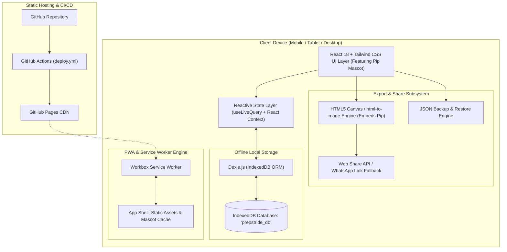
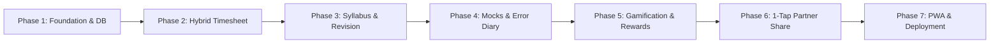

# Technical Requirements Document (TRD)

## Project Name: PrepStride
**Tagline:** Local-First PWA for UPSC CSE Preparation & Timesheet Management  
**Architecture:** Local-First Progressive Web Application (PWA)  
**Hosting Target:** GitHub Pages (Static Hosting, \$0 Operational Cost)  
**Framework & Tooling:** React 18 / TypeScript / Vite / Tailwind CSS / Lucide Icons  
**Storage Engine:** Dexie.js (IndexedDB Wrapper with Reactive `useLiveQuery`)  
**PWA Runtime:** `vite-plugin-pwa` with Workbox Service Worker  
**Brand Mascot:** **Pip the Stride Bird** (UI mascot assets in `/public/assets/mascot.png`)  

---

## 1. System Architecture Overview



---

## 2. Technology Stack & Decision Rationale

| Layer | Selection | Justification |
| :--- | :--- | :--- |
| **Language** | **TypeScript 5.x** | Strong static typing for UPSC syllabus structures, test calculations, and time logs. Eliminates runtime crashes. |
| **UI Framework** | **React 18** | Mature ecosystem, modular component architecture, and native integration with Dexie reactive hooks (`useLiveQuery`). |
| **Build Tool** | **Vite 5+** | Instant Hot Module Replacement (HMR), tree-shaking, fast production builds, and native PWA plugin support. |
| **Styling** | **Tailwind CSS 3.4+** | Utility-first, mobile-responsive classes; built-in dark mode support; minimal CSS bundle footprint ($< 15\text{ KB}$). |
| **Icons & Mascot** | **Lucide React + Pip Assets** | Feather-light SVG icons combined with optimized PNG/WebP assets for Pip the Stride Bird. |
| **Local Database** | **Dexie.js 4.x** | High-performance, Promise-based IndexedDB wrapper. Provides indexed queries, schema versioning, transactions, and live reactivity. |
| **PWA Engine** | **`vite-plugin-pwa`** | Automated Web App Manifest generation, pre-caching of all static bundles, seamless offline fallback, and auto-update prompts. |
| **Sharing Subsystem** | **`html-to-image` / Canvas API** | Renders HTML summary elements (with mascot artwork) directly into PNG images locally in browser with zero server dependencies. |
| **Hosting & CI/CD** | **GitHub Pages + Actions** | Completely free, zero maintenance, global CDN distribution, automatic build and deployment on git push. |

---

## 3. Database Schema & Data Models (Dexie.js)

The application stores all data locally in IndexedDB under the database name `prepstride_db`.

```typescript
import Dexie, { Table } from 'dexie';

// 1. Time Log Model (Timer & Retro entries)
export interface TimeLog {
  id?: number;
  date: string;              // ISO format 'YYYY-MM-DD'
  startTime: string;         // ISO timestamp
  endTime: string;           // ISO timestamp
  durationMinutes: number;   // Study time in minutes
  subject: SubjectCategory;  // 'GS1' | 'GS2' | 'GS3' | 'GS4' | 'OPTIONAL' | 'ESSAY' | 'CSAT' | 'CURRENT_AFFAIRS'
  topic: string;             // e.g. "Polity - Fundamental Rights"
  mode: 'pomodoro' | 'stopwatch' | 'manual';
  notes?: string;
  createdAt: number;
}

// 2. Daily Summary & Wellbeing Model
export interface DailyRecord {
  date: string;              // Primary Key 'YYYY-MM-DD'
  targetMinutes: number;     // e.g. 480 (8 hours)
  actualMinutes: number;     // Computed sum from TimeLog
  energyRating?: number;     // 1 to 5
  focusRating?: number;      // 1 to 5
  reflection?: string;       // 1-2 sentence journal note
  partnerSharedAt?: string;  // Timestamp of last share
}

// 3. Daily UPSC Ritual Checklist
export interface DailyRituals {
  date: string;              // Primary Key 'YYYY-MM-DD'
  newspaperRead: boolean;    // The Hindu / Indian Express
  editorialNotes: boolean;   // Notes taken
  mcqsCompleted: number;     // e.g. 15
  answersWritten: number;    // e.g. 2
  csatPracticed: boolean;
  currentAffairsMag: boolean;
}

// 4. Micro-Topic Syllabus Item
export interface SyllabusItem {
  id: string;                // e.g. 'gs1-hist-modern-01'
  paper: 'PRELIMS' | 'GS1' | 'GS2' | 'GS3' | 'GS4' | 'OPTIONAL_P1' | 'OPTIONAL_P2' | 'CSAT';
  category: string;          // e.g. 'Modern Indian History'
  microTopic: string;        // e.g. 'Socio-Religious Reform Movements'
  status: 'not_started' | 'first_reading' | 'notes_done' | 'rev_1' | 'rev_2' | 'mastered';
  revisionCount: number;
  lastRevisedAt?: string;    // 'YYYY-MM-DD'
  nextRevisionDue?: string;  // 'YYYY-MM-DD'
  priority: 'high' | 'medium' | 'low';
}

// 5. Mock Test Record
export interface MockTestRecord {
  id?: number;
  date: string;              // 'YYYY-MM-DD'
  examType: 'PRELIMS' | 'MAINS';
  testName: string;          // e.g. 'Vision IAS FLT 1'
  subject: string;           // 'Full Length' | 'Polity' | etc.
  totalQuestions: number;    // Typically 100 for Prelims
  attempted: number;
  correct: number;
  incorrect: number;
  calculatedScore: number;   // (correct * 2) - (incorrect * 0.666)
  accuracyRate: number;      // (correct / attempted) * 100
  notes?: string;
}

// 6. Prelims Mistake Diary
export interface MistakeLog {
  id?: number;
  mockTestId?: number;
  subject: string;
  questionSummary: string;
  category: 'silly_error' | 'conceptual_gap' | 'factual_lapse' | 'overthinking';
  correctConcept: string;    // Key learning to avoid repetition
  createdAt: number;
}

// 7. Standard Booklist & Resource Item
export interface ResourceItem {
  id?: number;
  title: string;             // e.g. "Indian Polity by M. Laxmikanth"
  subject: string;
  totalChapters: number;
  completedChapters: number;
  currentRevision: number;   // 0, 1, 2, 3+
}

// 8. Badges of Honor Model
export interface Badge {
  id: string;                // e.g. 'polity_sovereign', 'editorial_hawk'
  title: string;             // e.g. "Polity Sovereign"
  description: string;
  category: 'revision' | 'consistency' | 'rituals' | 'tests' | 'hours';
  icon: string;              // Lucide icon or Pip variant name
  unlockedAt?: string;       // ISO timestamp when unlocked
}

// 9. Partner Treat Box (Coupons) Model
export interface PartnerTreat {
  id: string;                // e.g. 'chefs_special', 'movie_night'
  title: string;             // e.g. "Partner Cooks Favorite Dinner"
  description: string;
  requiredXP: number;        // e.g. 1500 XP to unlock
  icon: string;
  isCustom: boolean;         // true if added by couple
  isUnlocked: boolean;
  isRedeemed: boolean;
  redeemedAt?: string;
}

// 10. Gamification & Streak State Model
export interface GamificationState {
  id: string;                // 'current_gamification'
  currentXP: number;
  currentLevel: number;      // 1 to 7
  levelTitle: string;        // e.g. "District Magistrate in the Making"
  currentStreak: number;     // Days consecutive
  longestStreak: number;
  streakShields: number;     // 0 to 3 (Rest Day Grace)
  unlockedThemes: string[];  // ['warm-paper', 'mussoorie-mist', 'midnight']
  lastStudyDate: string;     // 'YYYY-MM-DD'
}

// 11. Application Settings
export interface AppSettings {
  id: string;                // 'current_settings'
  targetYear: number;        // e.g. 2027
  examDate?: string;         // 'YYYY-MM-DD'
  defaultDailyTargetMinutes: number;
  optionalSubjectName: string; // e.g. 'PSIR'
  timerSettings: {
    workDuration: number;    // e.g. 50 min
    breakDuration: number;   // e.g. 10 min
    soundEnabled: boolean;
  };
  theme: 'warm-paper' | 'dark' | 'zen-forest' | 'mussoorie-mist' | 'lbsnaa-gold';
}
```

### Database Class Implementation (`src/db/index.ts`)
```typescript
export class PrepStrideDatabase extends Dexie {
  timeLogs!: Table<TimeLog, number>;
  dailyRecords!: Table<DailyRecord, string>;
  dailyRituals!: Table<DailyRituals, string>;
  syllabusItems!: Table<SyllabusItem, string>;
  mockTests!: Table<MockTestRecord, number>;
  mistakeLogs!: Table<MistakeLog, number>;
  resources!: Table<ResourceItem, number>;
  badges!: Table<Badge, string>;
  partnerTreats!: Table<PartnerTreat, string>;
  gamification!: Table<GamificationState, string>;
  settings!: Table<AppSettings, string>;

  constructor() {
    super('prepstride_db');
    this.version(1).stores({
      timeLogs: '++id, date, subject, mode, createdAt',
      dailyRecords: 'date',
      dailyRituals: 'date',
      syllabusItems: 'id, paper, category, status, nextRevisionDue',
      mockTests: '++id, date, examType, subject',
      mistakeLogs: '++id, mockTestId, category, subject',
      resources: '++id, subject',
      badges: 'id, category, unlockedAt',
      partnerTreats: 'id, isUnlocked, isRedeemed',
      gamification: 'id',
      settings: 'id'
    });
  }
}

export const db = new PrepStrideDatabase();
```

---

## 4. Key Subsystem Implementations

### 4.1 Hybrid Time Tracker Subsystem
- **State Engine:** Persistent Web Worker / LocalStorage timer ticker so timer continues accurately even if mobile browser minimizes or screen sleeps.
- **Auto-Sync to Timesheet:** When Pomodoro or Stopwatch session finishes, it writes a `TimeLog` transaction to Dexie and updates today's `DailyRecord.actualMinutes`.
- **Quick Retro-Modal:** Direct entry form with 1-tap pre-selected minute buttons (`[30m]`, `[45m]`, `[1h]`, `[1.5h]`, `[2h]`, `[3h]`).

### 4.2 Spaced Repetition Scheduling Algorithm
When an aspirant marks an item as revised:
$$\text{Next Revision Date} = \text{Current Date} + \Delta_{\text{interval}}$$
Where intervals progress exponentially:
- $\text{Revision 1} \rightarrow +3 \text{ days}$
- $\text{Revision 2} \rightarrow +7 \text{ days}$
- $\text{Revision 3} \rightarrow +21 \text{ days}$
- $\text{Revision 4+} \rightarrow +60 \text{ days}$
Items whose `nextRevisionDue \le \text{today}` automatically populate the active "Due for Revision" queue.

### 4.3 1-Tap Partner Share Engine (Featuring Mascot Pip)
1. **Visual Card Generation:** 
   - Uses an off-screen DOM card template styled with Tailwind CSS, embedding Pip the Stride Bird cheering on the card.
   - Converts the element to a clean PNG data URL via `html-to-image` in $< 300\text{ ms}$.
2. **Web Share API with Fallbacks:**
```typescript
export async function shareDailyDigest(cardBlob: Blob, textSummary: string) {
  if (navigator.share && navigator.canShare && navigator.canShare({ files: [new File([cardBlob], 'prepstride-day.png')] })) {
    await navigator.share({
      title: 'PrepStride Daily Summary',
      text: textSummary,
      files: [new File([cardBlob], 'prepstride-day.png', { type: 'image/png' })]
    });
  } else {
    // Fallback: Copy formatted text to clipboard & open WhatsApp
    await navigator.clipboard.writeText(textSummary);
    const whatsappUrl = `https://api.whatsapp.com/send?text=${encodeURIComponent(textSummary)}`;
    window.open(whatsappUrl, '_blank');
  }
}
```

### 4.4 Data Backup & Restore Subsystem
- **Export:** Serializes all 11 Dexie tables into a structured JSON payload:
```json
{
  "version": 1,
  "exportedAt": "2026-10-24T18:50:00.000Z",
  "appName": "PrepStride",
  "data": {
    "timeLogs": [...],
    "dailyRecords": [...],
    "dailyRituals": [...],
    "syllabusItems": [...],
    "mockTests": [...],
    "mistakeLogs": [...],
    "resources": [...],
    "badges": [...],
    "partnerTreats": [...],
    "gamification": [...],
    "settings": [...]
  }
}
```
- **Restore:** Reads uploaded `.json` file, validates schema version, executes a Dexie transaction to wipe and re-hydrate all tables, and confirms completion with zero data loss.

### 4.5 Gamification, Leveling & Reward Subsystem
- **XP Calculation & Event Dispatcher:**
  ```typescript
  export const LEVEL_THRESHOLDS = [
    { level: 1, minXP: 0, title: "The Novice Aspirant", mascotAccessory: "fledgling" },
    { level: 2, minXP: 500, title: "Discipline Disciple", mascotAccessory: "scarf" },
    { level: 3, minXP: 1500, title: "Foundation Master", mascotAccessory: "notebook" },
    { level: 4, minXP: 3500, title: "Mains Strategist", mascotAccessory: "spectacles" },
    { level: 5, minXP: 7000, title: "Revision Virtuoso", mascotAccessory: "quill" },
    { level: 6, minXP: 12000, title: "District Magistrate in the Making", mascotAccessory: "badge" },
    { level: 7, minXP: 20000, title: "LBSNAA Valedictorian", mascotAccessory: "golden_sash" }
  ];
  ```
- **Streak Shield ("Rest Day Grace") Auto-Protection Engine:**
  On application launch or daily rollover, checks if yesterday's study target was met. If missed, checks for a stored Streak Shield (up to 3) to protect the streak, presenting Pip sleeping peacefully under a leaf blanket.
- **Partner Treat Coupon Redemption Engine:**
  When user unlocks or redeems a coupon (e.g. *Chef's Special* dinner), it marks `isRedeemed = true` in `partnerTreats` and sends a pre-composed WhatsApp message:
  ```typescript
  export async function redeemPartnerTreat(treat: PartnerTreat) {
    const message = `🎉 PrepStride Milestone Reward!\n\nI just redeemed my reward coupon: "${treat.title}" (${treat.description})! ❤️\nLooking forward to celebrating this milestone together!`;
    const whatsappUrl = `https://api.whatsapp.com/send?text=${encodeURIComponent(message)}`;
    window.open(whatsappUrl, '_blank');
  }
  ```

---

## 5. PWA Configuration & Offline Strategy

### Web App Manifest (`vite.config.ts`)
```typescript
import { defineConfig } from 'vite';
import react from '@vitejs/plugin-react';
import { VitePWA } from 'vite-plugin-pwa';

export default defineConfig({
  base: './', // Essential for GitHub Pages relative asset paths
  plugins: [
    react(),
    VitePWA({
      registerType: 'autoUpdate',
      includeAssets: ['favicon.svg', 'apple-touch-icon.png', 'assets/mascot.png', 'icons/*.png'],
      manifest: {
        name: 'PrepStride - UPSC Progress & Timesheet Companion',
        short_name: 'PrepStride',
        description: 'Quiet, cheerful UPSC preparation tracker, timesheet, and revision companion with Pip',
        theme_color: '#FBF9F5', // Warm paper aesthetic
        background_color: '#FBF9F5',
        display: 'standalone',
        orientation: 'portrait',
        icons: [
          {
            src: 'icons/pwa-192x192.png',
            sizes: '192x192',
            type: 'image/png'
          },
          {
            src: 'icons/pwa-512x512.png',
            sizes: '512x512',
            type: 'image/png',
            purpose: 'any maskable'
          }
        ]
      },
      workbox: {
        globPatterns: ['**/*.{js,css,html,ico,png,svg,json}'],
        runtimeCaching: [
          {
            urlPattern: ({ request }) => request.destination === 'image',
            handler: 'CacheFirst',
            options: {
              cacheName: 'images-cache',
              expiration: { maxEntries: 50, maxAgeSeconds: 60 * 60 * 24 * 30 }
            }
          }
        ]
      }
    })
  ]
});
```

---

## 6. GitHub Pages CI/CD Deployment Pipeline

The static bundle will be built and published using GitHub Actions via `.github/workflows/deploy.yml`:

```yaml
name: Deploy PrepStride to GitHub Pages

on:
  push:
    branches: [ main ]
  workflow_dispatch:

permissions:
  contents: read
  pages: write
  id-token: write

concurrency:
  group: "pages"
  cancel-in-progress: false

jobs:
  build-and-deploy:
    environment:
      name: github-pages
      url: ${{ steps.deployment.outputs.page_url }}
    runs-on: ubuntu-latest
    steps:
      - name: Checkout Code
        uses: actions/checkout@v4

      - name: Setup Node.js 20
        uses: actions/setup-node@v4
        with:
          node-version: 20
          cache: 'npm'

      - name: Install Dependencies
        run: npm ci

      - name: Build Production Bundle
        run: npm run build

      - name: Setup Pages
        uses: actions/configure-pages@v4

      - name: Upload Pages Artifact
        uses: actions/upload-pages-artifact@v3
        with:
          path: './dist'

      - name: Deploy to GitHub Pages
        id: deployment
        uses: actions/deploy-pages@v4
```

---

## 7. Directory Structure

```
├── .github/
│   └── workflows/
│       └── deploy.yml               # Automated GitHub Pages CI/CD
├── public/
│   ├── favicon.svg
│   ├── assets/
│   │   └── mascot.png               # Official Mascot: Pip the Stride Bird
│   ├── icons/                       # PWA maskable icons
│   └── data/
│       ├── prelims_syllabus.json    # Complete Prelims micro-topics
│       ├── mains_gs1_4.json         # Complete Mains GS 1-4 micro-topics
│       └── optional_templates/      # PSIR, Sociology, Geography, etc.
├── src/
│   ├── assets/                      # Styles & static graphics
│   ├── components/
│   │   ├── common/                  # Buttons, Modals, Sliders, MascotAvatar
│   │   ├── dashboard/               # Pip Greeting, D-Day counter, Progress Ring
│   │   ├── timer/                   # Pomodoro & Stopwatch Zen views (Pip Focus Mode)
│   │   ├── timesheet/               # Retro-entry modal & daily timelines
│   │   ├── syllabus/                # Micro-topic checklist & tree explorer
│   │   ├── revision/                # Spaced repetition queue & rev tracker
│   │   ├── tests/                   # Prelims mock scoring & error diary
│   │   ├── rewards/                 # Pip Ranks, Badges of Honor, Treat Box coupons
│   │   ├── books/                   # Reference book progress tracker
│   │   ├── partner/                 # Share card preview (with Pip) & generator
│   │   └── analytics/               # GitHub-style contribution heatmap
│   ├── db/
│   │   ├── index.ts                 # Dexie.js database instance & tables
│   │   ├── seed.ts                  # Default syllabus, books & default treat coupons
│   │   └── backup.ts                # JSON export & restore engine
│   ├── hooks/                       # Custom hooks (useTimer, useHeatmap, useGamification)
│   ├── types/                       # TypeScript interfaces & types
│   ├── utils/                       # Score formulas, gamification rules, date formatters
│   ├── App.tsx                      # Root component with tab navigation
│   └── main.tsx                     # Entry point & PWA registration
├── index.html
├── package.json
├── tailwind.config.js               # Warm aesthetic color palettes
├── tsconfig.json
└── vite.config.ts                   # Vite + PWA + Base path setup
```

---

## 8. Step-by-Step Implementation Roadmap



1. **Phase 1: Project Scaffolding & Offline DB Setup**
   - Initialize Vite + React + TypeScript + Tailwind CSS.
   - Configure Dexie.js database, schema migrations, and initial syllabus seeds.
   - Configure Pip mascot assets in `/public/assets/mascot.png`.
2. **Phase 2: Hybrid Timesheet & Timer Engine**
   - Build Pomodoro & Stopwatch with background resilience.
   - Implement frictionless Quick Retro Log modal ($< 3\text{ seconds}$).
   - Build daily timeline and circular hours progress meter with Pip.
3. **Phase 3: Micro-Topic Syllabus & Spaced Revision System**
   - Pre-load complete Prelims & Mains GS 1–4 official topics.
   - Implement Optional subject template selector (PSIR, Sociology, Geography, etc.) and custom topic editor.
   - Implement Revision queue with spaced repetition interval calculator.
4. **Phase 4: Mock Test Scoring & Mistake Diary**
   - Prelims scoring calculator with automatic negative mark deductions.
   - Categorized mistake logbook with search filter.
5. **Phase 5: Gamification, Badges of Honor & Partner Treat Box**
   - Study XP engine and Civil Services Journey rank progression with Pip evolution states.
   - UPSC milestone badges (Polity Sovereign, Editorial Hawk, Negative Marking Tamer, etc.).
   - Streak Shield ("Rest Day Grace") burnout prevention logic.
   - Unlockable themes and redeemable Partner Treat Box coupons with WhatsApp redemption trigger.
6. **Phase 6: 1-Tap Partner Share & Analytics**
   - HTML-to-Image visual daily card generator featuring Pip.
   - Web Share API and WhatsApp quick-link integration.
   - 365-day GitHub-style study heatmap and subject distribution charts.
7. **Phase 7: PWA Optimization, Backup Engine & GitHub Pages Deployment**
   - Service worker caching with `vite-plugin-pwa` for 100% offline usage.
   - 1-click JSON backup/restore with integrity checks.
   - Setup GitHub Actions workflow for zero-maintenance automated deployment.
